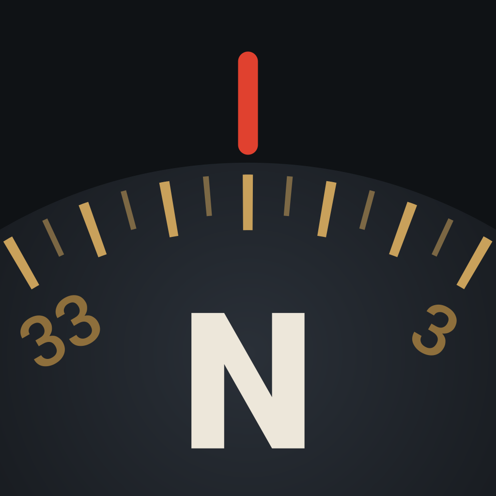
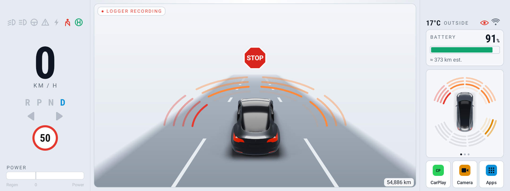
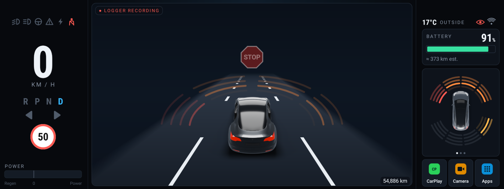

<p align="center"></p>

<h1 align="center">Binnacle</h1>

<p align="center">A **read-only** replacement instrument-cluster app and tooling for the Carview / ZIQI "A007" 10.25" Tesla Model 3/Y Android cluster (sold as Hansshow / Tesery / VJOYCAR / Satonic).</p>

Aimed at fixing some of the jank in the shipped software. We were promised over the air updates which never came. After trying to patch the app, I ended up fixing the app by just replacing it with the help of Claude. This whole new dash uses the same real car data (speed, battery %, gear, odometer, TPMS, lights, parking sensors, doors) and also supports correctly handing off to CarPlay / Android Auto and the forward camera. The install is fully reversible.





*Parked, light and dark themes. The red "● REC" badge and eye show because the optional logger is installed and running.*

## Why "Binnacle"?
On a ship, the binnacle is the stand in front of the helm that holds the compass, lit so the helmsman can read it at a glance.

## Features
- **Live car data, never written to:** speed, gear (R P N D), speed-limit sign, indicators and lights, power and regen bar, tyre pressures (psi or bar), parking sensors, doors, boot and frunk, outside temperature, odometer.
- **Your car, in rendered 3D:** Shows whichever door is open, opens it, and highlights the boot and frunk. In Drive it sits on a moving road with headlight glow, and on Autopilot the lane turns blue (or a rainbow road, if you like). Model 3 or Model Y (asked on first start), left- or right-hand drive, in the original dash's colour options. Different car colours are available via the app and downloaded from this repo.
- **Left/Right hand drive:** Graphics are correct to your car's side of the road with easier to access touch targets for your spare hand.
- **Real battery %:** decoded from a field the stock software mislabels (see below), with a range estimate and charging animation.
- **Efficiency:** Wh/km over the last 5 km, a 15-minute power and regen graph, and this drive's totals.
- **GPS compass**
- **Parking sensors you can read:** coloured arcs around the car, a STOP sign when you're close, and a sensor card that stays visible while the camera is up.
- **Forward camera inside the dash:** now is the picture is actually smooth.
- **Autopilot attention warning:** a blue LED bar that pulses out from the centre, with a soft breathing glow around the centre window.
- **CarPlay on your terms:** starts only when you tap CarPlay, and one tap ends it and rejoins your home Wi-Fi.
- **Light, dark or Auto theme:** Auto follows the screen brightness the car sets, so it goes dark with the car at night.
- **Steering-wheel control**
- **Rainbow road on Autopilot** 'nuf said.

## What it fixes compared with the stock dash
- **Model Y Support:** the stock dash only showed a Model 3 - now the Model Y is supported as a graphic.
- **Android Settings Access:** the stock dash went out of its way to hide the normal Android Settings app, Binnacle restores this.
- **Battery %:** on some cars (mine included) had the stock "battery level" field stuck at 77%, and the stock dash shows another field as "km" when it isn't range at all. Binnacle decodes the real % from that second field, checked against a full 13 % to 100 % charge.
- **Camera that works:** the stock camera could fail with "camera error 4" after a reboot and judders on the 56 Hz panel. Binnacle sets up the camera input itself, paces frames evenly, and hides the start-up roll.
- **CarPlay that doesn't hijack your phone:** with the stock setup, CarPlay grabbed the phone and the unit's Wi-Fi whenever it could. Now it only connects when asked.
- **No stray Popups:** the stock dash's background pop-ups over the screen are gone. No more full-screen picture up every time a door or the boot opens. Binnacle keeps your dash in view and shows the doors on its own car instead.
- **Warnings that clear on time:** the attention warning goes away when the car clears it, not seconds later.
- **Theme that doesn't flip-flop:** Auto waits for the car's light level to settle before switching.

## Planned/Hoped for Features.
- CarPlay/Android Auto in the centre of the screen.
- Restore 2nd Bluetooth device on the dash.
- Installed Navigation apps in the centre of the screen with access to Cached data.
- Improved design with more options, particularly for centre screen.

## Install
No computer or adb needed for the basics.
1. Download the latest `Binnacle-<version>.apk` from this project's [Releases](https://github.com/lotech/binnacle/releases).
2. Copy it to a USB stick, plug the stick into the unit, open it in the unit's file manager and tap the APK. Android asks once to allow installing apps from the file manager.
3. Open **Binnacle**. The setup wizard asks about your car (model, steering-wheel side, colour), offers to make Binnacle the Home app, and asks for the compass (location) and in-dash camera. Any step can be skipped; **Apps → Advanced → Run setup** shows it again.
4. Optional extras that hide the stock camera screen and stock pop-ups need a one-time change on the unit itself: see `docs/UNIT-CHANGES.md` (and `docs/ADB-GUIDE.md` for network ADB). **End CarPlay** and **Bluetooth auto-connect** also use network ADB; without it, End CarPlay opens Android's Wi-Fi screen instead.

To remove it: **Apps → Advanced → Remove Binnacle**. The stock dash was never removed and comes straight back.

## The hardware (what the listings don't tell you)
Sold as an "Android 12" 10.25" cluster for the Model 3 and Model Y under several brands. Inside, it's a ZIQI "A007" board.

| | |
|---|---|
| **Android** | **Android 10** (API 29). The build and About screen say 12, but the system is 10 underneath, so apps that need Android 11 or 12 won't run. |
| **SoC** | Unisoc UMS512, not MediaTek. |
| **Firmware** | `A007-userdebug` build (Feb 2023), with a fingerprint borrowed from a Vastking tablet. It's a debug build: SELinux is permissive, the bootloader is unlocked and `su` gives root. ZIQI's update server has nothing published for it, so the promised OTA updates don't exist. |
| **Storage** | 64 GB eMMC (about 55 GB for apps and data). |
| **Screen** | 1920 × 720 at 320 dpi. The panel runs at **56 Hz**, which makes 30 fps video judder unless it's paced (Binnacle does this for the camera). |
| **Car data** | Two MCUs: one decodes the Tesla CAN bus and sends it over a serial port to the stock CAN app (`com.xbs.canapp`), which any app can subscribe to. Brake lights, true range and steering angle aren't in that feed, and on some cars the battery level is stuck (see above). |
| **Wi-Fi** | One radio. Wireless CarPlay turns it into a hotspot, so the unit drops off your home Wi-Fi (and ADB) while CarPlay is connected. |
| **Bluetooth** | A separate Goodocom module handles calls and audio. Android's own Bluetooth is off by default, so there's no Bluetooth LE and apps that need it (such as S3XY Commander) can't connect. |
| **CarPlay / Android Auto** | ZLink, preinstalled. The unit rolls ZLink back to its preinstalled version at every boot, so in-app updates don't stick. If [xcertplay](https://github.com/shilapi/xcertplay) is installed, Binnacle opens it for CarPlay instead and hides ZLink from its app list (ZLink stays installed). |
| **Camera** | A TP9950 decoder. Only the TVI 1080p 30 fps input format gives a clean picture with the supplied camera. |
| **GPS** | Built in. Its daemon crashes often and, as shipped, writes a large crash dump to storage each time. |
| **USB-C** | Host only: you can't use it for ADB. ADB works over Wi-Fi (see `docs/ADB-GUIDE.md`), and once on, it accepts connections from anything on your network without a key. |

Changes made to the unit itself (outside the app), each with its undo: are located in `docs/UNIT-CHANGES.md`. No stock apps were removed.

> **ABSOLUTE RULE — NOTHING TO THE CAR.** Nothing in this project ever sends anything onto the car's CAN bus or otherwise affects the car itself. The dash app *subscribes* to the stock CAN service and *receives* data. A write to the dash's own MCU is a narrow, owner-approved exception, one pinned message at a time, never assumed (see `CLAUDE.md`). This is enforced in code (one class, two allowed binder calls: subscribe/unsubscribe) and by build-time guards that refuse to build if any write path is referenced: `app/tools/check_readonly.sh` on the source and `app/tools/check_bytecode.sh` on the compiled classes and APK (the logger has its own pair in `capture/tools/`; `app/tools/test_guards.sh` checks that the guards still refuse known bypasses). Never weaken or bypass them.

## Status
In daily use on my 2023 Model 3 since 27 Oct 2026, as the unit's Home app (it replaces the stock dash; the stock launcher stays installed as the fallback).
- ✅ Reverse-engineered the stock CAN data interface and built a **field map** (`docs/FIELD_MAP.md`).
- ✅ An optional read-only **logger** (`capture/`), a developer tool that records the car data feed. It never records location, isn't installed by default, and is only started by the dash if you opt in.
- ✅ The **dash app** (`app/`): speed, gear, lights, power/regen, battery % (decoded, see below), tyres, parking sensors, doors, Autopilot, light/dark/auto theme, forward camera inside the dash, CarPlay start/end. See `app/README.md`.
- 🟡 Still open: split-screen CarPlay (ZLink draws at the wrong width), the car's Bluetooth reconnecting to the unit by itself, a phone-call/mic test.

## Layout
| Folder | What |
|---|---|
| `app/` | The replacement read-only dash app (installs as `com.xbs.launcher`, so the stock door pop-up stays away; code in `app.binnacle`) |
| `capture/` | Optional developer tool: Binnacle logger, a separate read-only app that records the car data feed (no location) to its private storage; used to derive the field map |
| `mockups/` | HTML mockups of the dash layout — **own artwork only**, no vendor assets |
| `docs/` | `FIELD_MAP.md` (decoded CAN fields), the ADB access guide, and `UNIT-CHANGES.md` (changes made to the unit outside the app) |
| `app/tests/` | Plain-Java tests (tyre pressure, battery decoding), run by `app/build.sh` |
| `app/assets/cars/` | The dash's car renders, made from a CC BY 4.0 model (see Credits) |

## Binnacle Log tool — build & install
This was an important part of the project to understand all the information coming from the Dashes MCU and the CANBUS. It is **NOT** installed by default and must be installed manually via ADB. When installed it displays an obvious icon to indicate it is logging. I care about privacy and security so if installed an icon is displayed to indicate it is logging. This is a simple tool but record ALL the data for the last 7 days and so should be considered not something you would want unless you want to help the project.

It never records location. Logs stay in the logger's own private storage (not `/sdcard`), and uninstalling it deletes them all. The dash only starts it if you turn on Apps & settings → Advanced → **Drive logger: start with the dash**. While it's installed, the dash shows an eye beside the Wi-Fi icon and a badge in the centre window, both red while it's recording. Details: `capture/README.md`.

No Gradle required; it builds with the Android SDK command-line tools (`javac` → `d8` → `aapt2` → `apksigner`), or import `capture/` into Android Studio. Then:
```
adb connect <unit-ip>:5555
adb install -r capture/build/BinnacleLogger.apk
# open "Binnacle logger" on the unit and tap Start recording;
# "Export logs to Downloads" copies the logs out when you want them
```
It is **read-only** (subscribe + log only). Undo: `adb uninstall app.binnacle.logger`, or Advanced → Remove drive logger in Binnacle.

## Safety & reversibility
- The app only **reads** the stock CAN feed and never writes to the vehicle CAN bus. Writes to the dash's own MCU are acceptable but not preferred: each one needs the owner's go for that exact message and stays pinned in the guards (see `CLAUDE.md`).
- It installs as a normal app and is set as the default Home; the stock launcher stays installed as the fallback. No system-partition changes. Reverse by switching Home back (`adb shell su 0 cmd package set-home-activity com.xbs.launcher1/.MainActivity`) or uninstalling.
- The few things it does on the unit itself are pinned by the same guard: a fixed list of shell-user commands through the unit's own ADB (`LocalShell`: cycle Wi-Fi to end CarPlay, read/set Bluetooth auto-connect), and the camera decoder's two input-select nodes in `/sys/ziqi/camera`.

## Credits
3D car model by Ameer Studio (https://sketchfab.com/uchiha.321abc), source: https://sketchfab.com/3d-models/tesla-2018-model-3-5ef9b845aaf44203b6d04e2c677e444f, CC BY 4.0 (https://creativecommons.org/licenses/by/4.0/). Modified: recoloured, mirrored for RHD, posed, rendered.

Model Y renders (dark grey right-hand drive bundled, the rest downloaded from the release): based on "2021 Tesla Model Y" (https://sketchfab.com/3d-models/2021-tesla-model-y-59e2ead369984b1a85c800ff6cf6789d) by tonielpro520 (https://sketchfab.com/tonielpro520), CC BY 4.0 (https://creativecommons.org/licenses/by/4.0/). Modified: recoloured, doors separated and hinged, mirrored for right-hand drive, posed, rendered.

The in-app credit is under **Apps & settings → Advanced → About**.

## Licence
Code: MIT (see `LICENSE`). Car renders in `app/assets/cars/` and the release packs: CC BY 4.0, from 3D models by Ameer Studio (Model 3) and tonielpro520 (Model Y), modified (see Credits). Not affiliated with Tesla, ZIQI or any head-unit vendor; "Tesla", "Model 3" and "Model Y" are used only to say which car this is for.
